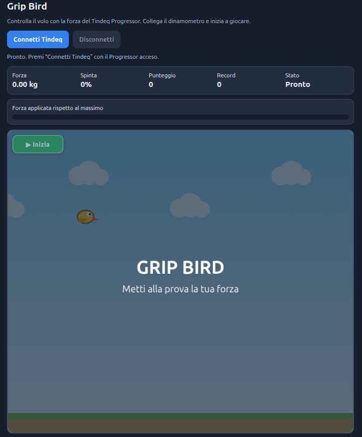

# Grip Bird — Tindeq Progressor

Un gioco ispirato a Flappy Bird, controllato attraverso la forza di trazione misurata dal Tindeq Progressor.

Allena la tua forza di presa divertendoti: tira il dinamometro per far volare l'uccellino, evita gli ostacoli e cerca di ottenere il punteggio più alto!



> **[Gioca a Grip Bird](https://andreaamanzo.github.io/grip-bird-tindeq-progressor/)**

---

## Come funziona

Grip Bird utilizza i dati di forza trasmessi via Bluetooth LE dal Tindeq Progressor per controllare il volo dell'uccellino.

- **Trazione:** applicando forza al dinamometro, l'uccellino sale.
- **Rilascio:** quando riduci la trazione, la gravità fa scendere l'uccellino.
- **Obiettivo:** attraversare gli ostacoli senza colpirli e accumulare punti.

La forza applicata viene visualizzata in tempo reale, insieme alla spinta generata e al punteggio.

## Requisiti

Per utilizzare il gioco sono necessari:

- Un dispositivo Tindeq Progressor.
- Bluetooth Low Energy (BLE).
- Un browser compatibile con Web Bluetooth API.
- Una connessione HTTPS.

### Browser compatibili

| Piattaforma | Browser | Supporto |
|---|---|---|
| Windows | Google Chrome | Sì |
| Windows | Microsoft Edge | Sì |
| Windows | Brave | Sì |
| macOS | Google Chrome | Sì |
| Android | Google Chrome | Sì |
| iOS | Safari / Chrome / Brave | No |

**Nota:** Web Bluetooth non è attualmente supportato nativamente da iOS. Anche Chrome su iPhone non permette di utilizzare direttamente questa API.

## Come giocare

1. Accendi il Tindeq Progressor.
2. Apri [Grip Bird](https://andreaamanzo.github.io/grip-bird-tindeq-progressor/) utilizzando un browser compatibile.
3. Premi **Connetti Tindeq**.
4. Seleziona il dispositivo nell'elenco Bluetooth.
5. Una volta stabilita la connessione, premi **Inizia**.
6. Controlla il volo dell'uccellino attraverso la forza di trazione!

## Personalizzazione

Il gioco permette di modificare diversi parametri per adattare la difficoltà e la risposta alla propria forza.

| Parametro | Descrizione |
|---|---|
| Sensibilità forza | Forza necessaria per raggiungere la spinta massima |
| Curva di risposta | Modifica la risposta alla trazione |
| Accelerazione di spinta | Intensità massima della spinta |
| Gravità | Intensità della gravità |
| Velocità massima salita | Limite della velocità verso l'alto |
| Velocità massima caduta | Limite della velocità verso il basso |
| Distanza tra i tubi | Regola la distanza degli ostacoli |
| Larghezza dei tubi | Regola la dimensione degli ostacoli |

È possibile ripristinare i parametri iniziali attraverso il pulsante **Ripristina**.

## Struttura del progetto

```text
grip-bird-tindeq-progressor/
├── index.html
├── style.css
├── script.js
├── assets/
│   └── screenshot.png
└── README.md
```

## Hosting

L'applicazione è pubblicata gratuitamente tramite GitHub Pages:

https://andreaamanzo.github.io/grip-bird-tindeq-progressor/

Ogni aggiornamento pubblicato sul branch principale del repository viene distribuito automaticamente.

## Contributi

Il progetto nasce come esperimento per combinare allenamento della forza e gioco.

Suggerimenti, segnalazioni di bug e idee per nuove funzionalità sono benvenuti.
